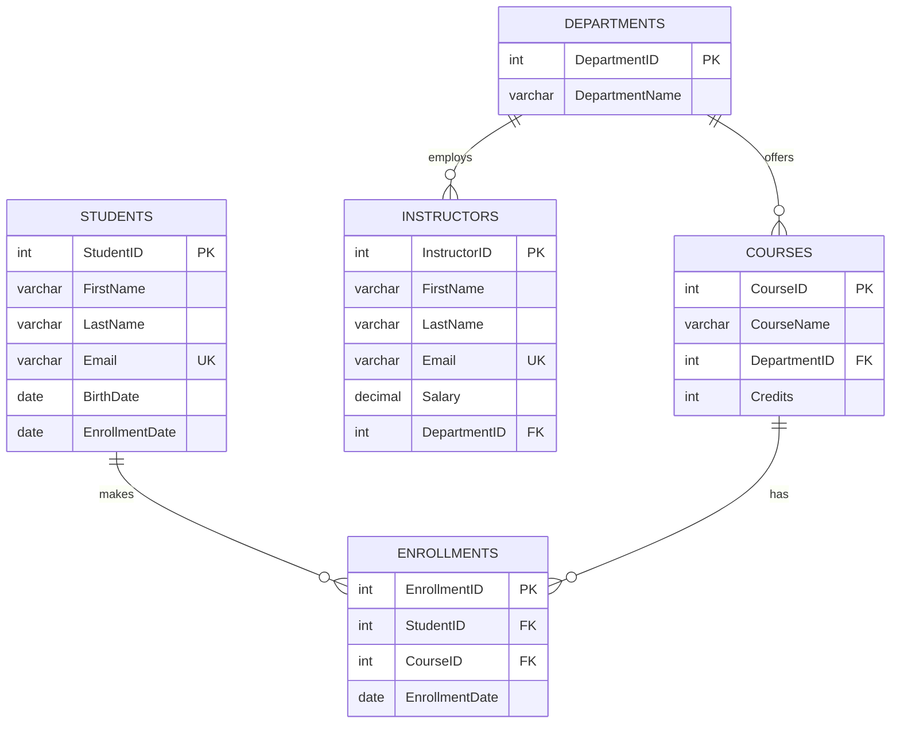

[README (11).md](https://github.com/user-attachments/files/33387724/README.11.md)
<div align="center">

# 🎓 University Database Management System

### A MySQL project covering schema design, CRUD, joins, aggregation, subqueries & window functions


</div>

---

## 📑 Table of Contents

- [Problem Statement](#-problem-statement)
- [Objectives](#-objectives)
- [Technologies Used](#-technologies-used)
- [Database Schema](#-database-schema)
- [Program Flow](#-program-flow)
- [Queries & Output](#-queries--output)
- [How to Run](#-how-to-run)
- [Key Learnings](#-key-learnings)
- [Author](#-author)

---

## 📌 Problem Statement

A university needs a reliable way to store and manage its academic data: **students, courses, departments, instructors and course enrollments**. Keeping this information in spreadsheets leads to duplicate records, broken relationships and slow reporting.

This project designs a **relational database (`UniversityDB`)** in MySQL that:

- Stores all university entities in properly related tables
- Enforces data integrity with primary keys, foreign keys, `UNIQUE`, `NOT NULL` and `DEFAULT` constraints
- Answers real-world questions such as *"Which students are enrolled in both SQL and Data Structures?"* or *"How many students are enrolled per department?"*

---

## 🎯 Objectives

- ✅ Design a normalized database with 5 related tables
- ✅ Apply **referential integrity** using `ON DELETE CASCADE` and `ON DELETE SET NULL`
- ✅ Perform **CRUD** operations (`INSERT`, `SELECT`, `UPDATE`, `DELETE`)
- ✅ Use **JOINs** (`INNER`, `LEFT`, multi-table, self-style double join)
- ✅ Apply **aggregate functions** (`COUNT`, `AVG`, `MAX`) with `GROUP BY` and `HAVING`
- ✅ Write **subqueries** and use `DISTINCT`
- ✅ Use **date and string functions** (`YEAR`, `TIMESTAMPDIFF`, `CONCAT`)
- ✅ Apply **window functions** (running total using `COUNT() OVER`)
- ✅ Use **conditional logic** with `CASE`

---

## 🛠 Technologies Used

| Technology | Purpose |
|------------|---------|
|  | Relational database management system |
|  | Query language (DDL, DML, DQL) |
|  | Command-line client used to execute the queries |
|  | Project documentation |

---

## 🗂 Database Schema

### Entity Relationship Diagram



### Table Summary

| Table | Description | Key Constraints |
|-------|-------------|-----------------|
| `Departments` | Academic departments | PK `DepartmentID` (auto-increment) |
| `Students` | Student personal & enrollment info | PK, `Email` UNIQUE |
| `Courses` | Courses offered | FK → Departments (`SET NULL`), `Credits` default 3 |
| `Instructors` | Faculty details and salary | FK → Departments (`SET NULL`), `Email` UNIQUE |
| `Enrollments` | Student ↔ Course mapping (many-to-many) | FK → Students & Courses (`CASCADE`) |

---

## 🔄 Program Flow

```mermaid
flowchart TD
    A([▶ Start]) --> B[Create Database<br/>UniversityDB]
    B --> C[Create Tables<br/>Departments, Students, Courses,<br/>Instructors, Enrollments]
    C --> D[Insert Sample Data<br/>3 Departments • 4 Students • 5 Courses<br/>3 Instructors • 5 Enrollments]
    D --> E[CRUD Operations]
    E --> E1[INSERT new student]
    E --> E2[UPDATE student email]
    E --> E3[DELETE student ID 4]
    E1 & E2 & E3 --> F[Filtering & Joins]
    F --> F1[Students enrolled after 2022]
    F --> F2[Courses of Mathematics dept]
    F --> F3[Students in SQL AND Data Structures]
    F --> F4[INNER JOIN / LEFT JOIN reports]
    F1 & F2 & F3 & F4 --> G[Aggregation & Subqueries]
    G --> G1[AVG credits]
    G --> G2[MAX CS instructor salary]
    G --> G3[Students per department]
    G --> G4[HAVING / subquery filters]
    G1 & G2 & G3 & G4 --> H[Advanced SQL]
    H --> H1[YEAR&#40;&#41; & CONCAT&#40;&#41;]
    H --> H2[Window function:<br/>Running total]
    H --> H3[CASE: Senior / Junior]
    H1 & H2 & H3 --> I([⏹ End])

    style A fill:#2ecc71,color:#fff
    style I fill:#e74c3c,color:#fff
    style B fill:#3498db,color:#fff
    style C fill:#3498db,color:#fff
    style D fill:#9b59b6,color:#fff
```



**Step-by-step summary**

1. **Setup** – create `UniversityDB` and select it.
2. **Schema creation** – create 5 tables with keys and constraints.
3. **Data loading** – insert sample departments, students, courses, instructors and enrollments.
4. **CRUD** – add a new student, update an email, delete a student.
5. **Querying** – filter, join, group, aggregate and use subqueries.
6. **Advanced analysis** – window function running total and `CASE` classification.

---

## 📊 Queries & Output

> 📸 **Add your screenshots** in an `images/` folder using the file names shown below. Text output is also provided in each collapsible section.

### 1️⃣ Database & Table Creation

```sql
CREATE DATABASE IF NOT EXISTS UniversityDB;
USE UniversityDB;
-- CREATE TABLE Departments, Students, Courses, Instructors, Enrollments
```


---

### 2️⃣ Insert Data & View Students

```sql
INSERT INTO Students (FirstName, LastName, Email, BirthDate, EnrollmentDate)
VALUES ('Charlie', 'Green', 'charlie.green@example.com', '2002-04-12', '2023-08-15');

SELECT * FROM Students;
```


<details>
<summary>📄 View text output</summary>

```
+-----------+-----------+----------+---------------------------+------------+----------------+
| StudentID | FirstName | LastName | Email                     | BirthDate  | EnrollmentDate |
+-----------+-----------+----------+---------------------------+------------+----------------+
|         1 | John      | Doe      | john.doe@example.com      | 2001-05-15 | 2021-08-20     |
|         2 | Jane      | Smith    | jane.smith@example.com    | 2002-11-23 | 2023-01-10     |
|         3 | Alice     | Brown    | alice.brown@example.com   | 2000-02-10 | 2020-09-01     |
|         4 | Bob       | White    | bob.white@example.com     | 2003-07-19 | 2024-02-15     |
|         5 | Charlie   | Green    | charlie.green@example.com | 2002-04-12 | 2023-08-15     |
+-----------+-----------+----------+---------------------------+------------+----------------+
```
</details>

---

### 3️⃣ Update & Delete

```sql
UPDATE Students SET Email = 'john.doe_updated@example.com' WHERE StudentID = 1;
DELETE FROM Students WHERE StudentID = 4;
```


---

### 4️⃣ Students Enrolled After 2022

```sql
SELECT * FROM Students WHERE YEAR(EnrollmentDate) > 2022;
```


<details>
<summary>📄 View text output</summary>

```
+-----------+-----------+----------+---------------------------+------------+----------------+
| StudentID | FirstName | LastName | Email                     | BirthDate  | EnrollmentDate |
+-----------+-----------+----------+---------------------------+------------+----------------+
|         2 | Jane      | Smith    | jane.smith@example.com    | 2002-11-23 | 2023-01-10     |
|         5 | Charlie   | Green    | charlie.green@example.com | 2002-04-12 | 2023-08-15     |
+-----------+-----------+----------+---------------------------+------------+----------------+
```
</details>

---

### 5️⃣ Courses in the Mathematics Department

```sql
SELECT c.*
FROM Courses c
JOIN Departments d ON c.DepartmentID = d.DepartmentID
WHERE d.DepartmentName = 'Mathematics'
LIMIT 5;
```


<details>
<summary>📄 View text output</summary>

```
+----------+----------------+--------------+---------+
| CourseID | CourseName     | DepartmentID | Credits |
+----------+----------------+--------------+---------+
|      103 | Linear Algebra |            2 |       3 |
|      104 | Calculus I     |            2 |       3 |
+----------+----------------+--------------+---------+
```
</details>

---

### 6️⃣ Students Enrolled in **Both** "Introduction to SQL" and "Data Structures"

```sql
SELECT s.StudentID, s.FirstName, s.LastName
FROM Students s
JOIN Enrollments e1 ON s.StudentID = e1.StudentID
JOIN Courses c1 ON e1.CourseID = c1.CourseID AND c1.CourseName = 'Introduction to SQL'
JOIN Enrollments e2 ON s.StudentID = e2.StudentID
JOIN Courses c2 ON e2.CourseID = c2.CourseID AND c2.CourseName = 'Data Structures';
```


<details>
<summary>📄 View text output</summary>

```
+-----------+-----------+----------+
| StudentID | FirstName | LastName |
+-----------+-----------+----------+
|         1 | John      | Doe      |
|         3 | Alice     | Brown    |
+-----------+-----------+----------+
```
</details>

---

### 7️⃣ Students Enrolled in **Either** Course

```sql
SELECT DISTINCT s.StudentID, s.FirstName, s.LastName
FROM Students s
JOIN Enrollments e ON s.StudentID = e.StudentID
JOIN Courses c ON e.CourseID = c.CourseID
WHERE c.CourseName IN ('Introduction to SQL', 'Data Structures');
```


<details>
<summary>📄 View text output</summary>

```
+-----------+-----------+----------+
| StudentID | FirstName | LastName |
+-----------+-----------+----------+
|         1 | John      | Doe      |
|         2 | Jane      | Smith    |
|         3 | Alice     | Brown    |
+-----------+-----------+----------+
```
</details>

---

### 8️⃣ Aggregate Functions

```sql
SELECT AVG(Credits) AS AverageCredits FROM Courses;

SELECT MAX(i.Salary) AS MaxCSInstructorSalary
FROM Instructors i
JOIN Departments d ON i.DepartmentID = d.DepartmentID
WHERE d.DepartmentName = 'Computer Science';
```


<details>
<summary>📄 View text output</summary>

```
+----------------+          +-----------------------+
| AverageCredits |          | MaxCSInstructorSalary |
+----------------+          +-----------------------+
|         3.6000 |          |              92000.00 |
+----------------+          +-----------------------+
```
</details>

---

### 9️⃣ Enrolled Students Count per Department

```sql
SELECT d.DepartmentName, COUNT(DISTINCT e.StudentID) AS EnrolledStudentsCount
FROM Departments d
JOIN Courses c ON d.DepartmentID = c.DepartmentID
JOIN Enrollments e ON c.CourseID = e.CourseID
GROUP BY d.DepartmentID, d.DepartmentName;
```


<details>
<summary>📄 View text output</summary>

```
+------------------+-----------------------+
| DepartmentName   | EnrolledStudentsCount |
+------------------+-----------------------+
| Computer Science |                     3 |
+------------------+-----------------------+
```
</details>

---

### 🔟 INNER JOIN vs LEFT JOIN

```sql
-- INNER JOIN: only students who have enrollments
SELECT s.StudentID, s.FirstName, s.LastName, c.CourseName
FROM Students s
INNER JOIN Enrollments e ON s.StudentID = e.StudentID
INNER JOIN Courses c ON e.CourseID = c.CourseID;

-- LEFT JOIN: all students, including those with no enrollment
SELECT s.StudentID, s.FirstName, s.LastName, c.CourseName
FROM Students s
LEFT JOIN Enrollments e ON s.StudentID = e.StudentID
LEFT JOIN Courses c ON e.CourseID = c.CourseID;
```


<details>
<summary>📄 View LEFT JOIN text output</summary>

```
+-----------+-----------+----------+---------------------+
| StudentID | FirstName | LastName | CourseName          |
+-----------+-----------+----------+---------------------+
|         1 | John      | Doe      | Data Structures     |
|         1 | John      | Doe      | Introduction to SQL |
|         2 | Jane      | Smith    | Data Structures     |
|         3 | Alice     | Brown    | Data Structures     |
|         3 | Alice     | Brown    | Introduction to SQL |
|         5 | Charlie   | Green    | NULL                |
+-----------+-----------+----------+---------------------+
```
> 💡 Charlie Green appears with `NULL` because he has no enrollments — this is the key difference from `INNER JOIN`.
</details>

---

### 1️⃣1️⃣ HAVING & Subquery (Popular Courses)

```sql
SELECT CourseID, COUNT(StudentID) AS TotalStudents
FROM Enrollments
GROUP BY CourseID
HAVING COUNT(StudentID) > 5;

SELECT DISTINCT s.StudentID, s.FirstName, s.LastName
FROM Students s
JOIN Enrollments e ON s.StudentID = e.StudentID
WHERE e.CourseID IN (
    SELECT CourseID FROM Enrollments
    GROUP BY CourseID HAVING COUNT(StudentID) > 10
);
```


> Both return `Empty set` because no course currently has more than 5 (or 10) students.

---

### 1️⃣2️⃣ Date Function & String Function

```sql
SELECT StudentID, FirstName, LastName, YEAR(EnrollmentDate) AS EnrollmentYear FROM Students;
SELECT InstructorID, CONCAT(FirstName, ' ', LastName) AS FullName FROM Instructors;
```


<details>
<summary>📄 View text output</summary>

```
+--------------+---------------+
| InstructorID | FullName      |
+--------------+---------------+
|            1 | Alice Johnson |
|            2 | Bob Lee       |
|            3 | Charlie Davis |
+--------------+---------------+
```
</details>

---

### 1️⃣3️⃣ Window Function – Running Total of Enrollments

```sql
SELECT EnrollmentID, CourseID, EnrollmentDate,
       COUNT(StudentID) OVER (ORDER BY EnrollmentDate, EnrollmentID) AS RunningTotalStudents
FROM Enrollments;
```


<details>
<summary>📄 View text output</summary>

```
+--------------+----------+----------------+----------------------+
| EnrollmentID | CourseID | EnrollmentDate | RunningTotalStudents |
+--------------+----------+----------------+----------------------+
|            4 |      101 | 2020-09-02     |                    1 |
|            5 |      102 | 2020-09-03     |                    2 |
|            1 |      101 | 2021-08-21     |                    3 |
|            2 |      102 | 2021-08-22     |                    4 |
|            3 |      102 | 2023-01-11     |                    5 |
+--------------+----------+----------------+----------------------+
```
</details>

---

### 1️⃣4️⃣ CASE Statement – Student Status

```sql
SELECT StudentID, FirstName, LastName, EnrollmentDate,
       CASE
           WHEN TIMESTAMPDIFF(YEAR, EnrollmentDate, CURDATE()) > 4 THEN 'Senior'
           ELSE 'Junior'
       END AS StudentStatus
FROM Students;
```


> ⚠️ The result depends on `CURDATE()`, so the Senior/Junior labels change as time passes.

---

## ▶️ How to Run

```bash
# 1. Clone the repository
git clone https://github.com/<your-username>/<your-repo>.git
cd <your-repo>

# 2. Log in to MySQL
mysql -u root -p

# 3. Run the script
mysql> SOURCE Tirth_8.sql;
```

Or from the terminal directly:

```bash
mysql -u root -p < Tirth_8.sql
```

> **Requirement:** MySQL 8.0+ (window functions are not supported in MySQL 5.7).

---

## 💡 Key Learnings

- How `ON DELETE CASCADE` removes dependent enrollments automatically, while `ON DELETE SET NULL` keeps courses/instructors when a department is deleted
- Difference between `INNER JOIN` and `LEFT JOIN`
- Using the same table twice (aliases `e1`, `e2`) to find students in **both** courses
- `WHERE` filters rows, `HAVING` filters groups
- Window functions calculate running totals without collapsing rows

---

## 👨‍💻 Author

<div align="center">

**Tirth**

[](https://github.com/your-username)
[](https://linkedin.com/in/your-profile)

⭐ If you found this project helpful, please give it a star!

</div>
